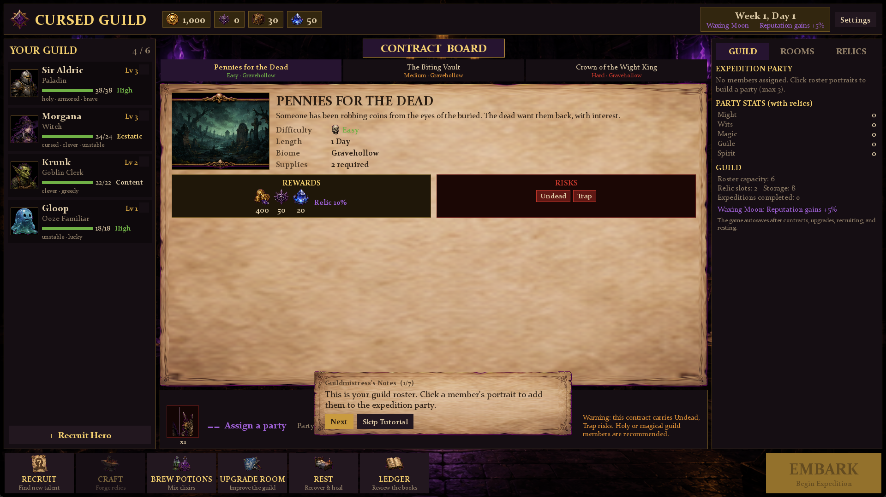

# Cursed Guild

A 2D dark-fantasy guild management game built with **Unreal Engine 5.8** (C++ / Slate, no editor assets).

You run a cursed guild: review your roster of monsters and misfits, choose contracts from the board,
assign a party of up to three, equip relics, and send them on auto-resolved expeditions. Spend the
loot on room upgrades, crafting, potions, and new recruits. Survive the weeks; mind the moon.



## Features (MVP vertical slice)

- **Guild Hub** matching the reference layout: top resource bar (Gold / Reputation / Supplies / Arcane Dust,
  week & moon phase), roster panel, contract board with parchment contract sheet, expedition preview,
  Guild / Rooms / Relics tabs, and a bottom action bar with a big gold **EMBARK** button.
- **12 guild members** (4 starting, 8 recruitable) with stats, traits, skills, mood, HP, injuries and level-ups.
- **20 handcrafted contracts** across 5 biomes, 3 difficulties, 3 lengths, with risk tags, stat challenges,
  special modifiers, and 15 enemy threat types shown in the preview.
- **20 relics** in 5 rarities with stat modifiers and passive effects (equip up to 3, vault-limited).
- **8 upgradeable rooms** with persistent bonuses (roster capacity, healing, crafting discounts,
  preview accuracy, relic slots, mood, ritual magic).
- **Expedition auto-resolution** per the design guide: party power vs. contract challenge, difficulty,
  mood, trait/class counters, relic and moon-phase modifiers → Great Success / Success / Partial /
  Failure / Disaster, with injuries, XP, relic finds, and reputation loss.
- **Day/week calendar** with moon phases, weekly board refresh and wage upkeep.
- **JSON save/load** with autosave after contracts, upgrades, recruiting and resting.
- **Tutorial popups**, settings (window mode / resolution), member detail sheets, guild ledger.

## Tech

- Pure C++ game module; the entire UI is code-built **Slate** (no UMG assets, no maps beyond `/Engine/Maps/Entry`).
- All game data lives in `Content/Data/*.json` — members, contracts, relics, rooms, enemies, and the
  sprite manifest are moddable without recompiling.
- Sprites load at runtime from PNG (`Content/Art/`); `Tools/slice_sprites.py` chroma-keys the
  AI-generated #FF00FF sheets in `images/` and slices them into transparent sprites.

## Build & Run

1. Install Unreal Engine 5.8 (the project's `EngineAssociation` is `5.8`).
2. Generate project files or build directly:
   ```
   <UE_5.8>/Engine/Build/BatchFiles/Build.bat CursedGuildEditor Win64 Development -project=<path>/CursedGuild.uproject
   ```
3. Launch:
   ```
   <UE_5.8>/Engine/Binaries/Win64/UnrealEditor.exe <path>/CursedGuild.uproject -game -windowed -resx=1920 -resy=1080
   ```

To regenerate sprites from the source sheets: `python Tools/slice_sprites.py` (requires Pillow + NumPy).

## Design

The full design document is in [`GameGuide.txt`](GameGuide.txt). The guide targets a generic 2D engine;
this implementation follows its systems, content lists, formulas, and UI layout in UE 5.8.
